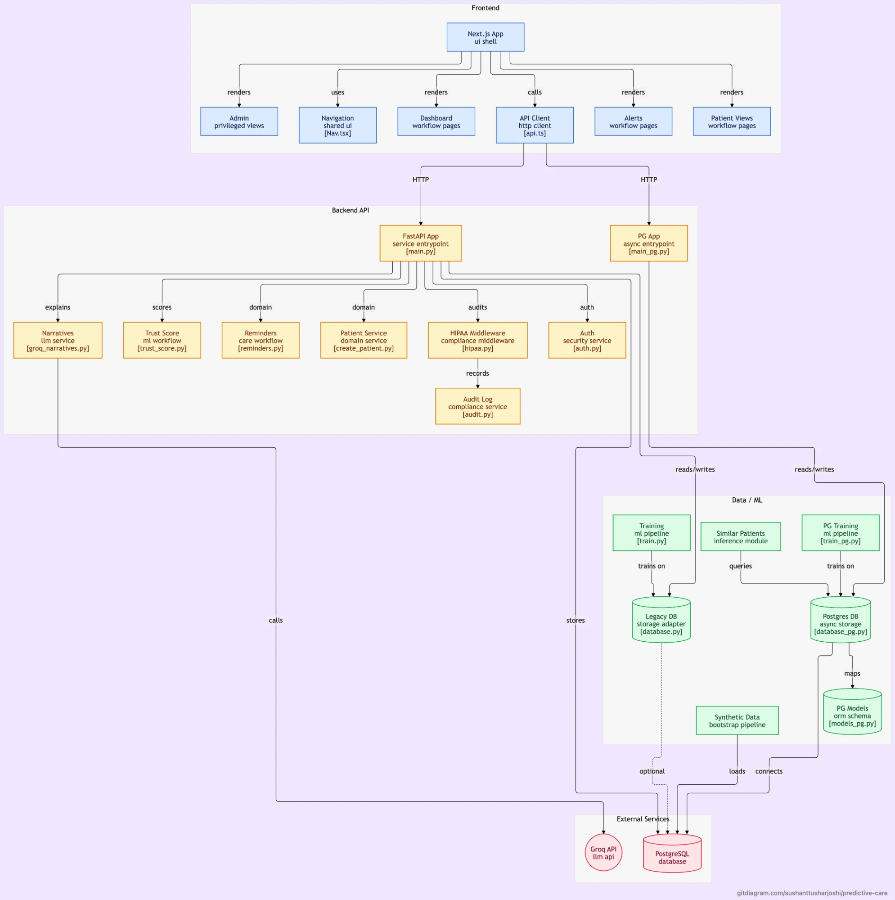

# PredictiveCare

Predicts ER-visit and care-need risk for a patient, explains each prediction with SHAP, turns the explanation into a
checked plain-English note, and keeps a clinician in charge of every scheduling decision.

Live demo: [predictive-care.vercel.app](https://predictive-care.vercel.app)

> Synthetic data only. Not clinically validated and not for clinical use. Demo logins are view-only for actions.

**Stack:** FastAPI, PostgreSQL 16, scikit-learn, XGBoost, LightGBM, SHAP, Groq or Amazon Bedrock, Next.js 15

---

## Architecture



The diagram predates this series: narratives now go through a provider chain (Groq or Bedrock) and local checks,
and training is the single `app.ml.train` script.

## What it adds

- Time-honest risk models: train on older patients, choose and calibrate on the next slice, report once on the newest.
- A logistic regression baseline next to XGBoost, LightGBM and their ensemble, with the decision threshold chosen on
  held-out data.
- Versioned model files that the API refuses to load if their sha256 does not match.
- SHAP explanations for every prediction, and LLM narratives that are shown only if they agree with that SHAP output.
- A medication trust score and tiered reminders (15 minutes, 5 minutes, due, 10 minutes missed).
- A clinician gate: the system recommends, a clinician approves on the Approvals page; demo accounts can only view.
- An audit-log row for every read of patient data, enforced by a test.

---

## ML

### Data and labels

- Postgres tables seeded by `app.data.ingest_synthea` (Synthea CSVs, or `--fallback` for generated patients).
- Index date = latest encounter minus 90 days. Features (17: demographics, insurance, diagnosis and medication
  counts, adherence now and a year earlier, response latency, vitals) use only events before it; labels use the
  30 or 90 days after it: `er_visit_30d`, `care_need_30d`, `care_need_90d`.

### Splits, models, calibration

- Patients sorted by time (first recorded encounter), cut 70/10/20 into train, calibration and test.
- Candidates fitted on train: logistic regression (baseline), XGBoost, LightGBM, and the average of the two tree
  models' log-odds.
- On the calibration slice only: pick the best ROC-AUC, choose isotonic or sigmoid calibration by cross-validated
  Brier (skipped, with the reason recorded, below 10 positives or negatives), and pick the F1-maximising threshold.
- On the test slice, once: ROC-AUC, PR-AUC, precision, recall, F1, Brier, reliability bins and ECE.

```bash
cd backend
python -m app.ml.train                                # from Postgres (DATABASE_URL_SYNC)
python -m app.ml.train --source memory --n 2000       # tiny in-memory run, no database
python -m app.ml.report data/models/metrics.json      # print the tables below
```

### Metrics (demo scale, synthetic)

From [docs/metrics/postgres-demo-600.json](docs/metrics/postgres-demo-600.json): 600 patients seeded with
`ingest_synthea --fallback --max-patients 600`, trained with `python -m app.ml.train` on 2026-11-27 (version `20261127T180858Z-2b2ebb2`).
Test slice: 120 patients.

| Target | Selected | ROC-AUC | PR-AUC | Brier | Threshold | Precision | Recall | F1 | Calibrated |
|---|---|---|---|---|---|---|---|---|---|
| er_visit_30d | logreg | 0.462 | 0.047 | 0.227 | 0.500 | 0.021 | 0.500 | 0.040 | no (0 positives in calibration slice) |
| care_need_90d | logreg | 0.523 | 0.180 | 0.123 | 0.168 | 0.157 | 0.471 | 0.235 | yes, sigmoid (ECE 0.360 to 0.051) |
| care_need_30d | logreg | 0.383 | 0.042 | 0.243 | 0.446 | 0.028 | 0.400 | 0.052 | no (3 positives in calibration slice) |

Test ROC-AUC per candidate (logreg / XGBoost / LightGBM / ensemble): er_visit_30d 0.462 / 0.568 / 0.525 / 0.534,
care_need_90d 0.523 / 0.427 / 0.399 / 0.404, care_need_30d 0.383 / 0.485 / 0.511 / 0.497.

These are chance-level, and that is the honest result: the fallback generator draws encounters independently of
every feature, so there is nothing to learn, and 2 to 17 test positives per target leave wide error bars.

Sanity check that the pipeline does learn when there is signal, from
[docs/metrics/memory-sanity-20k.json](docs/metrics/memory-sanity-20k.json)
(`python -m app.ml.train --source memory --n 20000`, outcomes drawn from a logistic function of the features):
test ROC-AUC 0.689 / 0.691 / 0.695 for the three targets, with sigmoid calibration lowering ECE to 0.014 / 0.021 /
0.017. The logistic baseline wins there by 0.004 to 0.012, as expected for a logistic ground truth.

Fairness: the same run reports error rates per adherence archetype on the test slice (admin page, Bias Audit tab).
Only care_need_90d has two groups with enough cases (5+ positives and negatives), and their gap is within noise.

Details, limits and the reliability numbers: [model card](docs/model-card.md).

---

## Narratives

| Layer | What happens | Code |
|---|---|---|
| De-identification | Names, birth date, address, ZIP and IDs removed; insurance mapped to a fixed list | `middleware/hipaa.py`, `services/narratives.py` |
| Guardrails (input) | Bedrock ApplyGuardrail on the prompt when `GUARDRAIL_ID` and `GUARDRAIL_VERSION` are set | `services/guardrails.py` |
| Provider chain | `NARRATIVE_PROVIDER=groq` (default) or `bedrock`; the other is the fallback; then the template | `services/llm_providers.py` |
| SHAP check | Every feature named must be in the patient's top 5 SHAP features, same direction, in size order; no out-of-model terms | `services/narrative_checks.py` |
| Rules | Never dosing advice, a diagnosis or causal wording | `services/narrative_checks.py` |
| Guardrails (output) | ApplyGuardrail on the narrative | `services/guardrails.py` |
| Cache and caps | Keyed by patient, model version and provider; daily caps on Bedrock and Guardrails calls | `services/narratives.py`, `services/guardrails.py` |
| Clinician gate | Narratives never act; scheduling needs a clinician through `/schedule/{id}/action` | `main.py` |

Any "no" returns the template, which is built from the same SHAP list. The response says which one you got
(`narrative_source`).

CI runs an [llm-eval-kit](https://github.com/SushantTusharJoshi/llm-eval-kit) suite
([backend/evals/](backend/evals/)) on every pull request: strict safety and SHAP cases plus quality cases within a
tolerance, with the mock provider, and a seeded-bad suite that must fail. With a `GROQ_API_KEY` secret it also runs
the suite on Groq.

Status: on 2026-11-27 the CI eval ran the suite live on Groq (`openai/gpt-oss-120b`, through llm-eval-kit): 9/9
cases passed, estimated cost $0.0004, and after the fix below all three narratives pass the exact SHAP check. The
app's own Groq call path, Bedrock and Guardrails are tested with stubs (including botocore's Stubber); live Bedrock
and Guardrails calls are implemented but unverified.

---

## Privacy controls (HIPAA-aligned)

Design controls, not a compliance claim: a real deployment would also need a business associate agreement, a risk
assessment and written policies.

- Every read of patient data writes an audit-log row (user, role, patient, time); [a test](backend/tests/test_audit_coverage.py) fails if a route forgets.
- De-identification before any LLM call, and a fixed list for the only free-text field that reaches a prompt.
- RBAC with four roles (admin, physician, nurse, coordinator); demo accounts are view-only for actions.
- JWT on every patient endpoint; CORS with credentials only for `FRONTEND_URL`; generic error bodies.

Model card: [docs/model-card.md](docs/model-card.md). Security findings and status: [SECURITY.md](SECURITY.md).

---

## Run locally

```bash
# Postgres 16 (Docker or Homebrew), then:
cd backend
python -m venv venv && source venv/bin/activate
pip install -r requirements.txt
cp .env.example .env                                   # DATABASE_URL, DATABASE_URL_SYNC, JWT_SECRET
python -m app.data.ingest_synthea --fallback --max-patients 600
python -m app.ml.train
uvicorn app.main:app --reload --port 8000

cd ../frontend && npm ci && npm run dev                # http://localhost:3000
python -m pytest -q                                    # from backend/
```

Demo logins (username = password) are on outside production: `admin`, `physician`, `dr.patel`, `nurse`,
`rn.williams`, `coordinator`. In production they are off unless `DEMO_LOGINS=true`, and they can view but not
approve, override, create patients or read the audit log. Real accounts go in `AUTH_USERS` as bcrypt hashes:

```bash
python -c "from passlib.context import CryptContext; print(CryptContext(schemes=['bcrypt']).hash('your-password'))"
# AUTH_USERS={"dr.kim": {"password_hash": "$2b$12$...", "role": "physician", "name": "Dr. Kim"}}
```

## Deploy on Railway

- The backend image is `backend/Dockerfile`; it starts `uvicorn app.main:app` (`app.main_pg:app` still works as an
  alias).
- Variables: `DATABASE_URL`, `DATABASE_URL_SYNC`, `JWT_SECRET`, `ENVIRONMENT=production`,
  `FRONTEND_URL=https://predictive-care.vercel.app`, `DEMO_LOGINS=true` for the public demo, `GROQ_API_KEY`.
  Optional: `NARRATIVE_PROVIDER`, `BEDROCK_MODEL_ID`, `AWS_REGION`, `GUARDRAIL_ID`, `GUARDRAIL_VERSION`,
  `BEDROCK_DAILY_CAP`, `GUARDRAIL_DAILY_CAP`, `MODEL_S3_URI`, `MODEL_VERSION`. AWS policy: [infra/aws/](infra/aws/README.md).
- After this series is merged, retrain on Railway with the new script, `python -m app.ml.train`. The API no longer
  loads the old unhashed `models.pkl`, so predictions show "Models not loaded" until then. `/health` reports
  `models_loaded` and `model_version`.

---

## Code map

Each function below has a `# What it does` / `# Catch it` / `# Card` header and `# STEP` / `# LOOP` / `# DECISION` /
`# RETURN` comments matching the boxes in its card's flowchart ([a test](backend/tests/test_cards.py) checks this).

| Box | File | The move |
|---|---|---|
| Time split | [ml/train.py](backend/app/ml/train.py) `time_split` | Sort by patient time, cut 70/10/20, newest last ([card](docs/cards/time-split.md)) |
| One target | [ml/train.py](backend/app/ml/train.py) `train_target` | Choose, calibrate and threshold on calibration; read test once ([card](docs/cards/train-target.md)) |
| Calibration | [ml/train.py](backend/app/ml/train.py) `fit_calibration` | Isotonic or sigmoid by CV Brier, or skip and say why ([card](docs/cards/calibration.md)) |
| Model file | [ml/artifacts.py](backend/app/ml/artifacts.py) `load_bundle` | Hash the bytes, compare, only then unpickle ([card](docs/cards/verified-artifact.md)) |
| SHAP check | [services/narrative_checks.py](backend/app/services/narrative_checks.py) `check_shap` | Each named feature: in top 5, same sign, in size order ([card](docs/cards/shap-check.md)) |
| Narrative chain | [services/narratives.py](backend/app/services/narratives.py) `narrate` | Cache, Guardrails, provider then fallback, checks; template on any no ([card](docs/cards/narrative-chain.md)) |
| Yes-streak | [services/trust_score.py](backend/app/services/trust_score.py) `consecutive_yes_streak` | One pass, reset on a miss ([card](docs/cards/yes-streak.md)) |
| Role check | [services/auth.py](backend/app/services/auth.py) `require_role` | Role allowed, then action permission with the demo flag ([card](docs/cards/rbac-demo.md)) |

## Known limits

| Limit | Impact |
|---|---|
| Synthetic data with no feature-outcome link in the fallback generator | Demo metrics are chance-level; nothing here says how the model would do on real patients |
| Small demo cohort | Calibration is skipped for two of three targets; test metrics have wide error bars |
| Fairness reported by archetype only, on too few cases | No group comparison can be trusted yet; race and sex not reported |
| Narrative cache, daily caps and rate limits are in-process | Each worker counts separately; restarts reset them |
| Live Bedrock and Guardrails calls unverified; the app's Groq client is stub-tested | Groq prompts were run live only through the CI eval |
| JWT in `localStorage`, no MFA or SSO | See [SECURITY.md](SECURITY.md) |
| Ingest uses ORM inserts | Large cohorts (100K patients) take hours to load |
