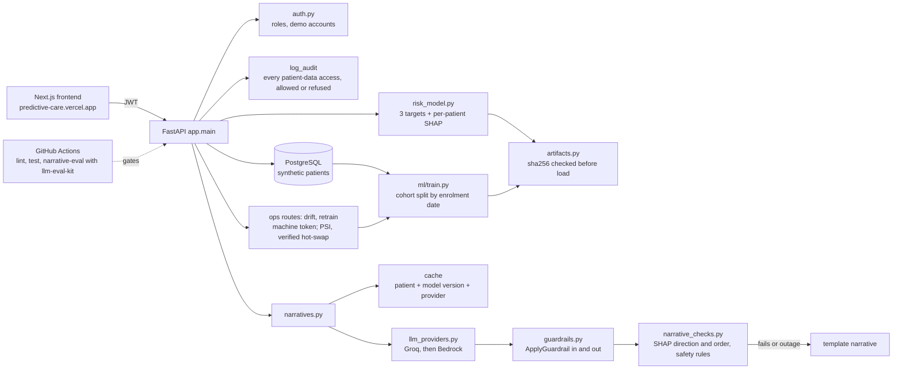

# PredictiveCare

Predicts ER-visit and care-need risk for a patient, explains each prediction with SHAP, turns the explanation into a
checked plain-English note, and keeps a clinician in charge of every scheduling decision.

Live demo: [predictive-care.vercel.app](https://predictive-care.vercel.app)

> Synthetic data only. Not clinically validated and not for clinical use. Demo logins use synthetic data and act with their full role; `DEMO_READ_ONLY=true` makes them view-only.

**Stack:** FastAPI, PostgreSQL 16, scikit-learn, XGBoost, LightGBM, SHAP, Groq or Amazon Bedrock, Next.js 15

---

## Architecture



Drawn from the code in `backend/app`: every box is a module, and every arrow is a call in it.

## What it adds

- Time-honest risk models: train on older patients, choose and calibrate on the next slice, report once on the newest.
- A logistic regression baseline next to XGBoost, LightGBM and their ensemble, with the decision threshold chosen on
  held-out data.
- Versioned model files that the API refuses to load if their sha256 does not match.
- SHAP explanations for every prediction, and LLM narratives that are shown only if they agree with that SHAP output.
- A medication trust score and tiered reminders (15 minutes, 5 minutes, due, 10 minutes missed).
- A clinician gate: the system recommends, a clinician approves on the Approvals page (demo accounts too, unless `DEMO_READ_ONLY=true`).
- Every access to patient data, allowed or refused, writes an audit_log row (patient, search, stats, prediction,
  schedule and `/audit` routes), with an `outcome` field; enforced by tests.

---

## ML

### Data and labels

- Postgres tables seeded by `app.data.ingest_synthea` (Synthea CSVs, or `--fallback` for generated patients).
- Planted outcome signal: the generator draws encounter types at random, so on its own there is nothing to learn.
  `app.data.rearrange_outcomes` (run at the end of `--fallback`, or standalone on an existing database) keeps every
  encounter row, date and type count and only moves the acute types (ER, urgent care, inpatient) toward patients
  with a higher risk under a documented rule: age, chronic diagnoses (heart failure, COPD, CKD and diabetes weigh
  most), smoking, SDOH count, BMI extremes, and poor or erratic adherence from the adherence events. The rule uses
  only data from before the index date and never the archetype label. It is seeded and idempotent. The rule and
  its weights are in the module header and the [model card](docs/model-card.md).
- Index date = latest encounter minus 90 days. Features (17: demographics, insurance, diagnosis and medication
  counts, adherence now and a year earlier, response latency, vitals) use only events before it; labels use the
  30 or 90 days after it: `er_visit_30d`, `care_need_30d`, `care_need_90d`.

### Splits, models, calibration

- Cohort split by enrolment date (the test set is the most recently enrolled patients over the same label window):
  patients sorted by enrolment date (first recorded encounter), cut 70/10/20 into train, calibration and test.
- Candidates fitted on train: logistic regression (baseline), XGBoost, LightGBM, and the average of the two tree
  models' log-odds.
- On the calibration slice only: pick the best ROC-AUC, choose isotonic or sigmoid calibration by cross-validated
  Brier (skipped, with the reason recorded, below 10 positives or negatives), and pick the F1-maximising threshold.
- On the test slice, once: ROC-AUC, PR-AUC, precision, recall, F1, Brier, reliability bins and ECE.

```bash
cd backend
python -m app.ml.train                                # from Postgres (DATABASE_URL_SYNC)
python -m app.ml.train --source memory --n 2000       # tiny in-memory run, no database
python -m app.ml.report data/models/metrics.json      # print the tables below
```

### Metrics (synthetic data, planted signal)

Read these as a check that the pipeline recovers a known, planted signal. They say nothing about clinical
validity: the patients are synthetic and the link between features and outcomes was put there by the rule above.

Run on 2026-11-27 against a throwaway Postgres seeded with `ingest_synthea --fallback --max-patients 1000`
(1,000 synthetic patients, 17,615 encounters), trained with `python -m app.ml.train`. Test slice: the newest 200
patients. Precision, recall and F1 are at the decision threshold chosen on the calibration slice (the one that
maximises F1 there), not at 0.5; metrics.json records it under `targets.<target>.threshold` and also reports
`f1_at_0_5`.

After `rearrange_outcomes`, from [docs/metrics/postgres-1000-planted.json](docs/metrics/postgres-1000-planted.json)
(version `20261127T205414Z-e025414`):

| Target | Selected | ROC-AUC | PR-AUC | Brier | Threshold | Precision | Recall | F1 | Calibrated | Test positives |
|---|---|---|---|---|---|---|---|---|---|---|
| er_visit_30d | logreg | 0.829 | 0.155 | 0.190 | 0.961 | 0.125 | 0.111 | 0.118 | no (5 positives in calibration slice) | 9 |
| care_need_90d | XGBoost | 0.681 | 0.281 | 0.133 | 0.163 | 0.227 | 0.625 | 0.333 | yes, sigmoid (ECE 0.181 to 0.063) | 32 |
| care_need_30d | XGBoost | 0.640 | 0.151 | 0.106 | 0.247 | 0.140 | 0.375 | 0.203 | no (8 positives in calibration slice) | 16 |

Before, same database with the generator's uniform encounter types, from
[docs/metrics/postgres-1000-before.json](docs/metrics/postgres-1000-before.json): test ROC-AUC 0.417 / 0.555 /
0.408 and F1 0.071 / 0.252 / 0.088 (thresholds 0.051 / 0.170 / 0.496) for er_visit_30d / care_need_90d /
care_need_30d. At a fixed 0.5 threshold care_need_90d had F1 = 0.

Test ROC-AUC per candidate after rearranging (logreg / XGBoost / LightGBM / ensemble): er_visit_30d 0.829 / 0.771 /
0.750 / 0.764, care_need_90d 0.723 / 0.681 / 0.692 / 0.689, care_need_30d 0.671 / 0.640 / 0.628 / 0.631. The
choice is made on a 100-patient calibration slice with 5 to 17 positives, so it is noisy; the test slice has 9 to
32 positives, so every number has a wide margin of error. Over eight other draws of a 1,000-patient in-memory cohort
with the same rule, care_need_90d test ROC-AUC ranged from 0.64 to 0.77.

Sanity check without the database, from [docs/metrics/memory-sanity-20k.json](docs/metrics/memory-sanity-20k.json)
(`python -m app.ml.train --source memory --n 20000`, outcomes drawn from a logistic function of the features):
test ROC-AUC 0.689 / 0.691 / 0.695 for the three targets, with sigmoid calibration lowering ECE to 0.014 / 0.021 /
0.017.

Fairness: the same run reports error rates per adherence archetype on the test slice (admin page, Bias Audit tab).
For care_need_90d four groups have enough cases (5+ positives and negatives); with 5 to 11 positives each, their
gaps are within noise. The planted rule makes poor adherence a risk factor, so that group is flagged more often by
design.

Details, limits and the reliability numbers: [model card](docs/model-card.md).

---

## Narratives

| Layer | What happens | Code |
|---|---|---|
| De-identification | Names, birth date, address, ZIP and IDs removed; insurance mapped to a fixed list | `middleware/hipaa.py`, `services/narratives.py` |
| Guardrails (input) | Bedrock ApplyGuardrail on the prompt when `GUARDRAIL_ID` and `GUARDRAIL_VERSION` are set | `services/guardrails.py` |
| Provider chain | `NARRATIVE_PROVIDER=groq` (default) or `bedrock`; the other is the fallback; then the template | `services/llm_providers.py` |
| SHAP check | Every feature named must be in the patient's top 5 SHAP features, same direction, in size order; no out-of-model terms | `services/narrative_checks.py` |
| Rules | Never dosing advice, a diagnosis or causal wording | `services/narrative_checks.py` |
| Guardrails (output) | ApplyGuardrail on the narrative | `services/guardrails.py` |
| Cache and caps | Keyed by patient, model version and provider; daily caps on Bedrock and Guardrails calls | `services/narratives.py`, `services/guardrails.py` |
| Clinician gate | Narratives never act; scheduling needs a clinician through `/schedule/{id}/action` | `main.py` |

Any "no" returns the template, which is built from the same SHAP list. The response says which one you got
(`narrative_source`).

CI runs an [llm-eval-kit](https://github.com/SushantTusharJoshi/llm-eval-kit) suite
([backend/evals/](backend/evals/)) on every pull request: strict safety and SHAP cases plus quality cases within a
tolerance, with the mock provider, and a seeded-bad suite that must fail. With a `GROQ_API_KEY` secret it also runs
the suite on Groq.

Status: on 2026-11-27 the CI eval ran the suite live on Groq (`openai/gpt-oss-120b`, through llm-eval-kit): 9/9
cases passed, estimated cost $0.0004, and after the fix below all three narratives pass the exact SHAP check. The
app's own Groq call path, Bedrock and Guardrails are tested with stubs (including botocore's Stubber); live Bedrock
and Guardrails calls are implemented but unverified.

---

## Privacy controls (HIPAA-aligned)

Design controls, not a compliance claim: a real deployment would also need a business associate agreement, a risk
assessment and written policies.

- Every access to patient data, allowed or refused, writes an audit_log row (user, role, patient, time, IP) on the
  patient, search, stats, prediction, schedule and `/audit` routes, including the admin's own reads of `/audit`.
  Routes log their successes; a middleware in `main.py` logs refused and failed attempts once each, with action
  `access_<outcome>` and `details.outcome` set to `unauthenticated` (401), `denied` (403), `not_found` (404),
  `invalid` (422), `rate_limited` (429), `rejected` (other 4xx) or `error` (5xx); successful `/audit` reads carry
  `outcome: allowed`. Only the route template, method and status are stored, never request bodies or PHI values.
  [Tests](backend/tests/test_audit_coverage.py) fail if a route forgets its success row or a refusal is not logged.
  `/models/metrics` and `/hipaa/data-flow` return no patient data and are not logged.
- De-identification before any LLM call, and a fixed list for the only free-text field that reaches a prompt.
- RBAC with four roles (admin, physician, nurse, coordinator); demo accounts use synthetic data and act with their full role, and `DEMO_READ_ONLY=true` makes them view-only for actions.
  Every write route needs an action permission as well as an allowed role: `record_responses` for
  `/patients/{id}/respond` (admin, physician, nurse), `override_predictions` for `/feedback` and `/override` (admin,
  physician), `create_recommendations` for `/schedule-recommendation` (admin, physician, coordinator: suggesting a
  follow-up is separate from approving it), `approve_recommendations` for `/schedule/{id}/action`, `create_patients`
  for `POST /patients`.
- JWT on every patient endpoint; CORS with credentials only for `FRONTEND_URL`; generic error bodies.

Model card: [docs/model-card.md](docs/model-card.md). Security findings and status: [SECURITY.md](SECURITY.md).

---

## Run locally

```bash
# Postgres 16 (Docker or Homebrew), then:
cd backend
python -m venv venv && source venv/bin/activate
pip install -r requirements.txt
cp .env.example .env                                   # DATABASE_URL, DATABASE_URL_SYNC, JWT_SECRET
python -m app.data.ingest_synthea --fallback --max-patients 600
python -m app.ml.train
uvicorn app.main:app --reload --port 8000

cd ../frontend && npm ci && npm run dev                # http://localhost:3000
python -m pytest -q                                    # from backend/
```

Demo logins (username = password) are on outside production: `admin`, `physician`, `dr.patel`, `nurse`,
`rn.williams`, `coordinator`. In production they are off unless `DEMO_LOGINS=true`. They use synthetic data and
act with their full role; with `DEMO_READ_ONLY=true` they can view but not approve, override, create patients or read
the audit log. Real accounts go in `AUTH_USERS` as bcrypt hashes:

```bash
python -c "from passlib.context import CryptContext; print(CryptContext(schemes=['bcrypt']).hash('your-password'))"
# AUTH_USERS={"dr.kim": {"password_hash": "$2b$12$...", "role": "physician", "name": "Dr. Kim"}}
```

## Monitoring

`GET /ops/drift` compares today's population with the training baseline. Training writes the baseline into
`metrics.json` (`drift_baseline`): decile bin edges and shares for every model feature (train slice) and for each
target's predicted score (held-out test slice). The endpoint rebuilds the features with the training SQL as of today
(newest `DRIFT_MAX_PATIENTS`, default 20,000), scores them with the loaded models, and returns:

- `features` and `scores`: PSI per item, `PSI = sum((live - base) * ln(live / base))` over the same bins, each with a
  status: `ok` under 0.1, `watch` 0.1 to 0.25, `drift` above 0.25. `top` lists the five largest.
- `status`: the worst item (`unknown` with a `reason` when the loaded metrics have no baseline; retrain once to add it).
- `overrides`: clinician overrides from `hitl_actions` (total, last 30 days) and how often the recorded model score
  and the clinician's score sit on the same side of the model's threshold, per target.
- `model_version`, `n_live`, `generated_at`. Each call writes an audit-log row (`view_drift`).

[monitor.yml](.github/workflows/monitor.yml) calls it nightly (and by hand), writes the table to the job summary,
opens or updates the one open issue labelled `drift` when the status is `drift`, and then runs the retrain workflow.

## Retraining

`POST /ops/retrain` runs the same pipeline as `python -m app.ml.train` in a background thread and answers 202 with a
`run_id`; a second request while one runs gets 409. When training finishes, the new artifact is loaded back through
the hash check, and its hash must equal the one training computed. Only then are the served models swapped in place
(no restart, `/health` shows the new `model_version`). If anything fails, the previous `current.json` and
`metrics.json` are put back, so a restart still loads the old model. `GET /ops/retrain` returns the last run
(`state`, `previous_version`, `new_version`, `verified`, `swapped`, `error`); it is also kept in
`retrain-status.json` on the volume, and a run cut off by a restart reads as failed. With `MODEL_VERSION` pinned the
new model is verified but not swapped. One run per process: keep the API at one worker (the Dockerfile runs one).

PC-F6, clinician overrides: they are an evaluation feedback set, never training labels, until there are at least 200
(`MIN_OVERRIDES_FOR_LABELS` in [ml/feedback.py](backend/app/ml/feedback.py)). Each training run scores the patients
behind the overrides with the new model and records the agreement in `metrics.json` (`override_feedback`, with the
rule and the count). Reaching 200 only marks them eligible; turning them into labels is a separate, reviewed change,
because an override is a clinician's risk estimate, not an observed outcome.

[retrain.yml](.github/workflows/retrain.yml) runs weekly (and by hand, and from the monitor on drift): it starts a
run, polls until it ends, and fails the job if the run failed or the new model did not verify.

Both `/ops` routes take a machine token, never a user JWT: `Authorization: Bearer $OPS_TOKEN`, compared in constant
time. Without `OPS_TOKEN` they return 503. Generate one with `openssl rand -hex 32`.

## Deploy

- The backend image is `backend/Dockerfile`; it starts `uvicorn app.main:app` (`app.main_pg:app` still works as an
  alias). The Railway service `predictive-care-api` has its root directory set to `backend`.
- Variables: `DATABASE_URL`, `DATABASE_URL_SYNC`, `JWT_SECRET`, `ENVIRONMENT=production`,
  `FRONTEND_URL=https://predictive-care.vercel.app`, `DEMO_LOGINS=true` for the public demo, `GROQ_API_KEY`,
  `OPS_TOKEN` for `/ops`. The models volume is mounted at `/app/data/models`, the default `MODEL_DIR`.
  Optional: `NARRATIVE_PROVIDER`, `BEDROCK_MODEL_ID`, `AWS_REGION`, `GUARDRAIL_ID`, `GUARDRAIL_VERSION`,
  `BEDROCK_DAILY_CAP`, `GUARDRAIL_DAILY_CAP`, `MODEL_S3_URI`, `MODEL_VERSION`, `DRIFT_MAX_PATIENTS`. AWS policy:
  [infra/aws/](infra/aws/README.md).
- Deploys are automatic: [deploy.yml](.github/workflows/deploy.yml) runs when the CI workflow (lint, test,
  narrative-eval) succeeds for a push to `main`, or by hand from `main`. It checks out the commit CI passed, installs
  the Railway CLI, runs `railway up --service predictive-care-api --detach` from the repo root, waits for that
  deployment to reach `SUCCESS`, then polls `/health` until it answers 200.
- GitHub settings for the workflows:

  | Workflow | Secrets | Variables |
  |---|---|---|
  | deploy.yml | `RAILWAY_TOKEN` (a Railway project token for production) | `API_BASE` |
  | monitor.yml | `OPS_TOKEN` (same value as on Railway) | `API_BASE` |
  | retrain.yml | `OPS_TOKEN` | `API_BASE` |

  `API_BASE` is the public API address, for example `https://<service>.up.railway.app`. Each workflow skips with a
  notice when its secret is missing.
- To plant the outcome signal in an existing database without regenerating it, run once in the backend
  service: `python -m app.data.rearrange_outcomes --dry-run` (writes nothing), then
  `python -m app.data.rearrange_outcomes`, then retrain. A second run changes 0 rows.
- The API only loads a hashed `models-<version>.pkl` named in `current.json`; until one exists, predictions show
  "Models not loaded". `POST /ops/retrain` (or `python -m app.ml.train` in the service) creates it. `/health` reports
  `models_loaded` and `model_version`.

---

## Code map

Each function below has a `# What it does` / `# Catch it` / `# Card` header and `# STEP` / `# LOOP` / `# DECISION` /
`# RETURN` comments matching the boxes in its card's flowchart ([a test](backend/tests/test_cards.py) checks this).

| Box | File | The move |
|---|---|---|
| Time split | [ml/train.py](backend/app/ml/train.py) `time_split` | Cohort split by enrolment date: sort, cut 70/10/20, most recently enrolled last ([card](docs/cards/time-split.md)) |
| One target | [ml/train.py](backend/app/ml/train.py) `train_target` | Choose, calibrate and threshold on calibration; read test once ([card](docs/cards/train-target.md)) |
| Calibration | [ml/train.py](backend/app/ml/train.py) `fit_calibration` | Isotonic or sigmoid by CV Brier, or skip and say why ([card](docs/cards/calibration.md)) |
| Model file | [ml/artifacts.py](backend/app/ml/artifacts.py) `load_bundle` | Hash the bytes, compare, only then unpickle ([card](docs/cards/verified-artifact.md)) |
| SHAP check | [services/narrative_checks.py](backend/app/services/narrative_checks.py) `check_shap` | Each named feature: in top 5, same sign, in size order ([card](docs/cards/shap-check.md)) |
| Narrative chain | [services/narratives.py](backend/app/services/narratives.py) `narrate` | Cache, Guardrails, provider then fallback, checks; template on any no ([card](docs/cards/narrative-chain.md)) |
| Yes-streak | [services/trust_score.py](backend/app/services/trust_score.py) `consecutive_yes_streak` | One pass, reset on a miss ([card](docs/cards/yes-streak.md)) |
| Role check | [services/auth.py](backend/app/services/auth.py) `require_role` | Role allowed, then action permission with the demo flag ([card](docs/cards/rbac-demo.md)) |
| Planted risk | [data/rearrange_outcomes.py](backend/app/data/rearrange_outcomes.py) `planted_risk` | Documented rule from pre-index features only ([card](docs/cards/planted-risk.md)) |
| Rearrange | [data/rearrange_outcomes.py](backend/app/data/rearrange_outcomes.py) `rearrange_encounters` | Seeded weighted draw moves acute types; rows and counts kept ([card](docs/cards/rearrange-outcomes.md)) |

## Known limits

| Limit | Impact |
|---|---|
| Synthetic data; the feature-outcome link is planted by a documented rule | Metrics show the pipeline recovers a known signal; nothing here says how the model would do on real patients |
| Small demo cohort | Calibration is skipped for two of three targets; test metrics have wide error bars |
| Fairness reported by archetype only, on too few cases | No group comparison can be trusted yet; race and sex not reported |
| Narrative cache, daily caps and rate limits are in-process | Each worker counts separately; restarts reset them |
| Live Bedrock and Guardrails calls unverified; the app's Groq client is stub-tested | Groq prompts were run live only through the CI eval |
| JWT in `localStorage`, no MFA or SSO | See [SECURITY.md](SECURITY.md) |
| Ingest uses ORM inserts | Large cohorts (100K patients) take hours to load |
| Retraining runs inside the API process | Requests slow down while it trains; one worker only, or two runs could overlap |
| Drift is measured as of today | A synthetic database whose events stopped in the past drifts on the 90-day features, and retraining on the same data will not clear it |

## About the coder

Built by [Sushant Joshi](https://github.com/SushantTusharJoshi), an AI engineer. The narrative eval gate here uses
[llm-eval-kit](https://github.com/SushantTusharJoshi/llm-eval-kit), another of my repos.
