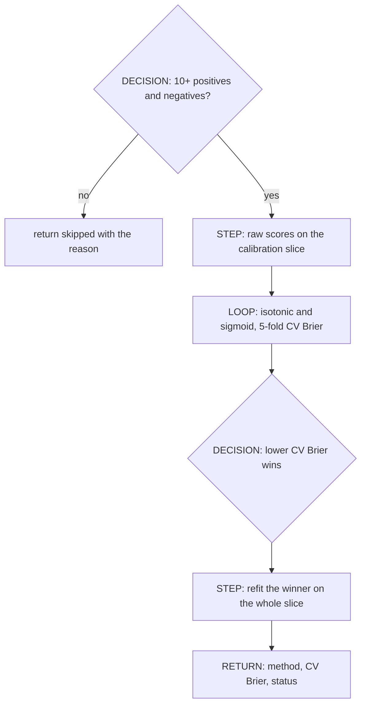

# Card: calibration on the calibration slice

Code: `fit_calibration` in [backend/app/ml/train.py](../../backend/app/ml/train.py).
Tests: `TestCalibration` and `test_reliability_and_ece_on_test` in [backend/tests/test_training.py](../../backend/tests/test_training.py).

## The question

"Your model says 30% risk. How do you make 30% mean 30 in 100, without touching the test set?"

## How to catch it in an interview

Listen for: probabilities, class weights, Brier, reliability diagram, "the scores look inflated". Class-balanced
training pushes scores up; a monotone map fitted on held-out data pulls them back without changing the ranking.

## Flowchart

## Slips (what this change fixed)

- Before: no calibration, so `scale_pos_weight` left probabilities far too high.
- Choosing isotonic vs sigmoid on the same rows it is fitted on always favours isotonic; cross-validation inside the
  slice avoids that.
- In the 600-patient demo two targets had 0 and 3 positives in the slice: calibration is skipped and metrics.json
  says so instead of claiming calibrated numbers.

## Interviewer questions and how the code answers

| Question | Answer in the code |
|---|---|
| Does calibration change AUC? | No: both maps are monotone, so the ranking is the same. |
| How do you know it worked? | ECE and Brier before and after on the test slice; `calibrated_metrics_valid` is false if test ECE got worse. |
| Does SHAP still hold? | SHAP explains the uncalibrated log-odds; a monotone map never flips a direction. |

## Twists

- Temperature scaling for a neural model: one parameter, same idea.
- Recalibrate per site when the base rate differs.
