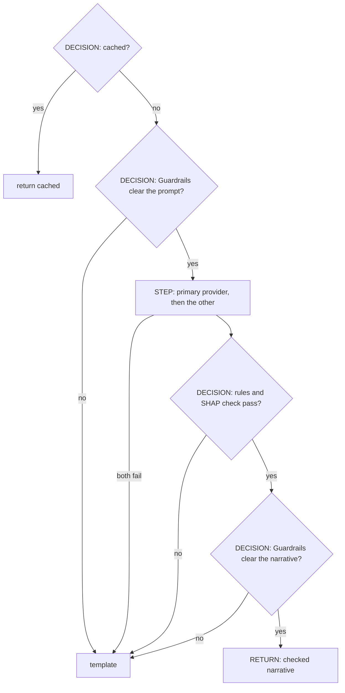

# Card: narrative chain with fallbacks

Code: `narrate` in [backend/app/services/narratives.py](../../backend/app/services/narratives.py).
Tests: `TestProviderChain`, `TestGuardrails`, `TestCacheAndCaps` in [backend/tests/test_narratives.py](../../backend/tests/test_narratives.py).

## The question

"Your LLM provider is down, or it says something unsafe. What does the clinician see?"

## How to catch it in an interview

Listen for: resilience, fallback, guardrails, cost. Layer the cheap checks, fail closed at every layer, and keep a
deterministic template as the floor.

## Flowchart

## Slips (what this change fixed)

- Before: one provider, no checks, and a Groq error silently fell back with no record of why.
- A guardrail error or a spent daily cap fails closed (template), never open.
- Provider failures are not cached, so the next request retries; check failures are cached, so a bad answer is not
  paid for twice.

## Interviewer questions and how the code answers

| Question | Answer in the code |
|---|---|
| What is in the cache key? | Patient, prediction type, model version, primary provider. A retrain misses the cache. |
| How do you cap spend? | `BEDROCK_DAILY_CAP` and `GUARDRAIL_DAILY_CAP`, per worker, reset at UTC midnight. |
| Can a narrative schedule anything? | No. Narratives are text; scheduling needs a clinician through `/schedule/{id}/action`. |
| Is it tested live? | No: stubs and botocore's Stubber only; live Groq and Bedrock are unverified. |

## Twists

- Move the cache and caps to Redis so they hold across workers.
- Stream the narrative and run the checks on the full text before showing it.
