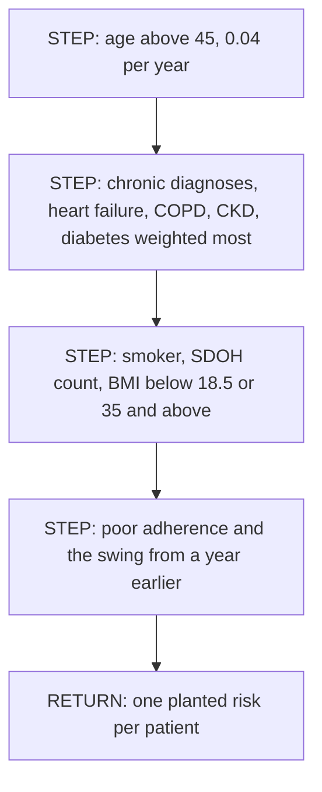

# Card: the planted risk rule

Code: `planted_risk` in [backend/app/data/rearrange_outcomes.py](../../backend/app/data/rearrange_outcomes.py).
Tests: `TestNoLeakage` in [backend/tests/test_rearrange_outcomes.py](../../backend/tests/test_rearrange_outcomes.py).

## The question

"Your synthetic data has no signal. How do you plant one without leaking the label?"

## How to catch it in an interview

Listen for: synthetic data, "the model is at chance", ground truth, leakage, "how do you know the pipeline works".
The answer: write the outcome rule down, build it only from what the model could know before the index date, and
check that the pipeline recovers it. A recovered planted signal tests the code, not clinical validity.

## Flowchart

## Slips (what this change fixed)

- Before: the generator drew every encounter type at random, so test ROC-AUC sat near 0.5 and F1 was near 0.
- The tempting shortcut is the archetype label; it is not a model input and is in `LEAKY_FEATURES`, so the rule
  uses adherence rates computed from the adherence events instead, with the same windows as training.
- Diagnoses count only if their onset is before the index date, as in the training query.

## Interviewer questions and how the code answers

| Question | Answer in the code |
|---|---|
| Could the rule leak the label? | It reads only `RISK_INPUTS`; a test checks none of them is in `LEAKY_FEATURES` and that shuffling the archetype or label columns does not move the risk. |
| Is the direction plausible? | Every weight is positive in the clinically expected direction; a test checks each one raises the risk. |
| Can the model see all of it? | Not all: it sees the diagnosis count, not the kind, so heart failure versus osteoarthritis is part of the noise it cannot explain. |

## Twists

- Add an interaction (for example heart failure with poor adherence) and see if the tree models beat the baseline.
- Plant a weaker signal and measure how many patients the pipeline needs to recover it.
