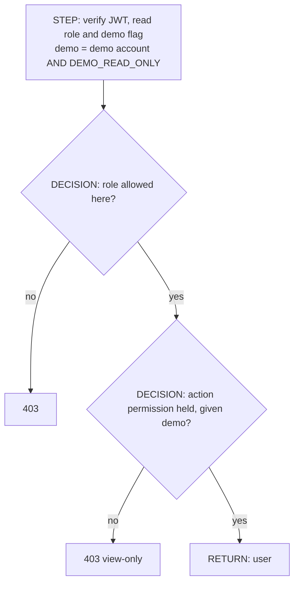

# Card: role check with an opt-in view-only switch for demo accounts

Code: `require_role` in [backend/app/services/auth.py](../../backend/app/services/auth.py).
Switch: `DEMO_READ_ONLY` (`demo_read_only` in [backend/app/config.py](../../backend/app/config.py)), off by default.
Tests: `TestDemoAccounts` (switch on), `TestDemoFullRoleByDefault` (switch off), `TestRealAccountsKeepPermissions` in [backend/tests/test_security.py](../../backend/tests/test_security.py).

## The question

"Your public demo shares an admin login. How do you stop it approving or reading the audit log?"

## How to catch it in an interview

Listen for: RBAC, least privilege, demo mode, tenant. Role says what a person is; a separate flag removes actions
from shared demo accounts without changing what real users can do. The demo runs on synthetic data, so by default
demo accounts act with their full role; `DEMO_READ_ONLY=true` turns the restriction on.

## Flowchart

## Slips (what this change fixed)

- Before: the demo admin could read the full audit log and approve recommendations.
- Tokens issued before the `demo` claim existed are still treated as demo, because the user table is checked too.
- Later: the owner chose full roles for the synthetic demo, so the restriction became the opt-in `DEMO_READ_ONLY`.
  `_restricted(flag)` is applied in `authenticate`, `create_token` and `is_demo_user`, so the login response, the
  token and the server check agree; the frontend banner and disabled buttons read that same flag.
- Error bodies no longer list the allowed roles.

## Interviewer questions and how the code answers

| Question | Answer in the code |
|---|---|
| Can demo accounts act? | Yes by default. With `DEMO_READ_ONLY=true`, `_restricted` marks them demo and `DEMO_DENIED` applies. |
| Which actions are withheld? | With the switch on, `DEMO_DENIED`: approve recommendations, override predictions, create patients, view audit, manage users. |
| Can a demo user forge `demo: false`? | Not without the JWT secret; and the user table still marks the name as demo. |
| Real admins? | `AUTH_USERS` accounts have `demo: False` and keep every role permission. |

## Twists

- Per-tenant data scoping on top of roles.
- Short-lived tokens with refresh, so a revoked demo flag applies within minutes.
