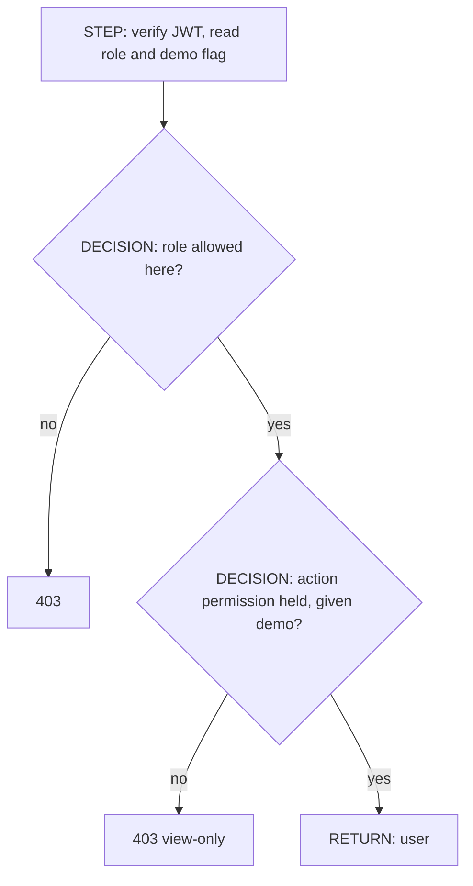

# Card: role check with view-only demo accounts

Code: `require_role` in [backend/app/services/auth.py](../../backend/app/services/auth.py).
Tests: `TestDemoAccounts`, `TestRealAccountsKeepPermissions` in [backend/tests/test_security.py](../../backend/tests/test_security.py).

## The question

"Your public demo shares an admin login. How do you stop it approving or reading the audit log?"

## How to catch it in an interview

Listen for: RBAC, least privilege, demo mode, tenant. Role says what a person is; a separate flag removes actions
from shared demo accounts without changing what real users can do.

## Flowchart

## Slips (what this change fixed)

- Before: the demo admin could read the full audit log and approve recommendations.
- Tokens issued before the `demo` claim existed are still treated as demo, because the user table is checked too.
- Error bodies no longer list the allowed roles.

## Interviewer questions and how the code answers

| Question | Answer in the code |
|---|---|
| Which actions are withheld? | `DEMO_DENIED`: approve recommendations, override predictions, create patients, view audit, manage users. |
| Can a demo user forge `demo: false`? | Not without the JWT secret; and the user table still marks the name as demo. |
| Real admins? | `AUTH_USERS` accounts have `demo: False` and keep every role permission. |

## Twists

- Per-tenant data scoping on top of roles.
- Short-lived tokens with refresh, so a revoked demo flag applies within minutes.
