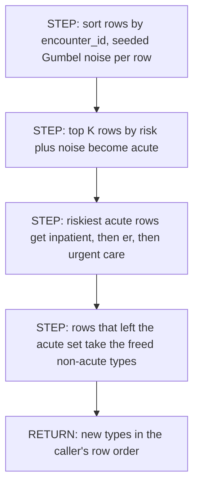

# Card: rearrange outcomes, create nothing

Code: `rearrange_encounters` in [backend/app/data/rearrange_outcomes.py](../../backend/app/data/rearrange_outcomes.py).
Tests: `TestRearrange` and `TestPipelineRecoversPlantedSignal` in
[backend/tests/test_rearrange_outcomes.py](../../backend/tests/test_rearrange_outcomes.py).

## The question

"How do you give synthetic outcomes a known signal without inventing a single row?"

## How to catch it in an interview

Listen for: synthetic data, weighted sampling, idempotent migration, "run it once on prod". The answer: keep every
row and every type count, and only move the acute types, with a seeded weighted draw that depends on nothing the
step changes, so a second run is a no-op.

## Flowchart

## Slips (what this change fixed)

- Before: every encounter type was drawn uniformly, independent of the patient, so the labels were noise.
- Drawing new rows would change the data volume and the time split; this step changes only `encounter_type`.
- Dates are left alone, so the index date (latest encounter minus 90 days) is the same before and after.
- A draw that reads the current types would not be idempotent; this one reads only rows, risk, seed and counts.

## Interviewer questions and how the code answers

| Question | Answer in the code |
|---|---|
| Why is K rows with the top risk plus Gumbel noise a weighted draw? | Taking the top K of log-weight plus Gumbel noise samples K rows without replacement with probability proportional to the weight, here exp(STRENGTH x risk). |
| What if it runs twice on the live database? | The same rows are chosen, so nothing changes; the Postgres test runs it twice and checks the second run changes 0 rows. |
| What if it fails halfway? | One transaction; it also re-counts the types before commit and raises (rolls back) if any count moved. |
| How strong is the signal? | `STRENGTH` = 1.5; in the 1,000-patient run the riskiest fifth of patients hold about half of the acute visits (83% of their encounters are acute, against 5% for the lowest fifth). |

## Twists

- Also move dates, for example clustering acute visits after weeks of missed doses, and keep it idempotent.
- Plant different rules per target (ER versus any care need) and check the models separate them.
