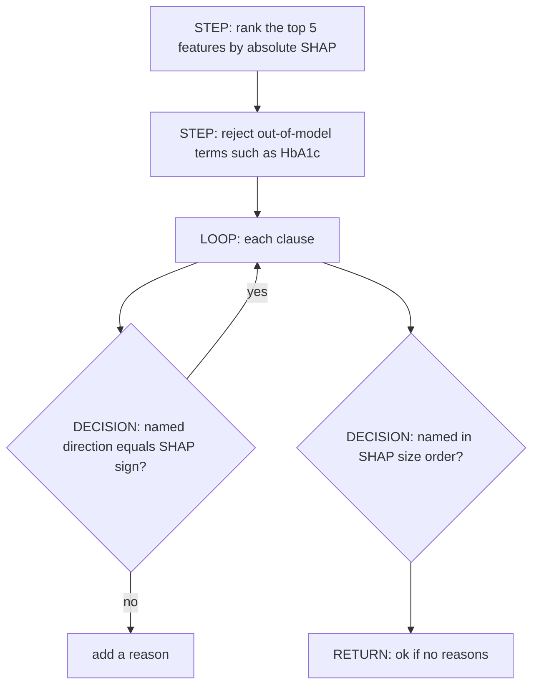

# Card: SHAP check on LLM narratives

Code: `check_shap` in [backend/app/services/narrative_checks.py](../../backend/app/services/narrative_checks.py).
Tests: `TestShapCheck` in [backend/tests/test_narratives.py](../../backend/tests/test_narratives.py), and the eval suite in [backend/evals/](../../backend/evals/).

## The question

"The LLM says BMI lowers risk but SHAP says it raises it. How do you catch that before a clinician reads it?"

## How to catch it in an interview

Listen for: hallucination, faithfulness, explanation, grounding. Treat the SHAP output as ground truth and check
every claim the text makes against it; when unsure, show the template.

## Flowchart

## Slips (what this change fixed)

- Before: the Groq text went straight to the page.
- "Lower adherence" is a value, not a direction; only verbs (raises, lowers, reduces) count as a claim.
- A clause that says both raises and lowers cannot be verified, so it fails rather than guessing.

## Interviewer questions and how the code answers

| Question | Answer in the code |
|---|---|
| What if the LLM names a feature outside the top 5? | "not in the top 5 SHAP features" reason; the template is shown. |
| Is a regex check enough? | It is strict and explainable; the prompt also asks for one factor per clause, largest first, so faithful text passes. |
| What does the clinician see on failure? | `_fallback_narrative`, built from the same SHAP list, which passes its own check (tested). |

## Twists

- Check numbers too: a stated probability must match the model's to the percent.
- Use an LLM judge as a second opinion, measured against human labels first.
