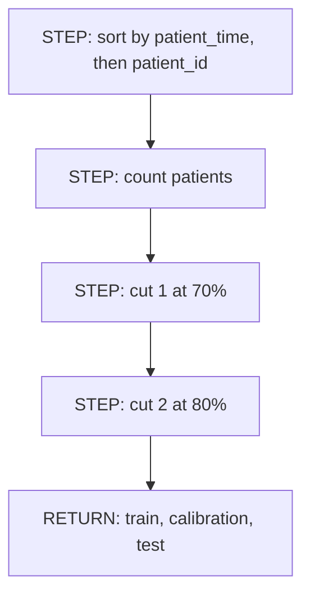

# Card: time-ordered split

Code: `time_split` in [backend/app/ml/train.py](../../backend/app/ml/train.py).
Tests: `TestSplit` in [backend/tests/test_training.py](../../backend/tests/test_training.py).

## The question

"Your model hit AUC 1.0 on a random split. How do you split so the test set looks like the future?"

## How to catch it in an interview

Listen for: leakage, "too good to be true", temporal data, deployment drift. The answer: sort by time, train on the
past, test on the newest patients, and keep a middle slice for every choice you make (model, calibration, threshold).

## Flowchart

## Slips (what this change fixed)

- Before: three scripts, two of them with a plain 80/20 split and the threshold fixed at 0.5, which gave F1 = 0.
- Sorting on time alone is not reproducible when many patients share a date; `patient_id` breaks the tie.
- The Postgres fallback data stamps every patient with the same `created_at`, so patient time is the first recorded
  encounter instead.

## Interviewer questions and how the code answers

| Question | Answer in the code |
|---|---|
| Can a patient be in train and test? | No: each patient is one row and the slices are disjoint ranges (`test_split_has_no_patient_in_two_slices`). |
| Why a calibration slice? | Model choice, calibration and threshold all need data the test set never sees. |
| Why not k-fold? | Shuffled folds let the model see the future; the time order is the point. |
| Where are the cut dates? | `metrics.json` records `from` and `to` per slice. |

## Twists

- Rolling origin: several index dates, each with its own train window, to see how stable the metrics are.
- Group by site or clinician as well as time, if the deployment moves to a new hospital.
