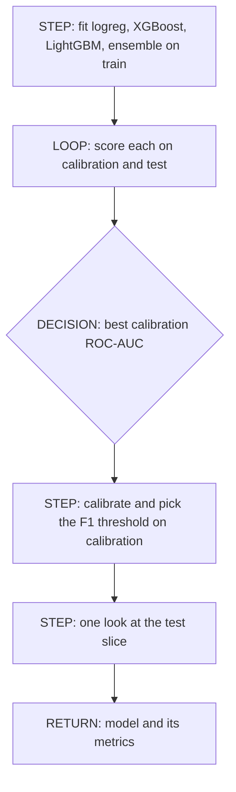

# Card: one target, end to end

Code: `train_target` in [backend/app/ml/train.py](../../backend/app/ml/train.py).
Tests: `TestMetrics` in [backend/tests/test_training.py](../../backend/tests/test_training.py).

## The question

"Where do you pick the model and the threshold so your test numbers stay honest?"

## How to catch it in an interview

Listen for: model selection, baseline, threshold tuning, F1 = 0, imbalanced labels. Every choice uses the
calibration slice; the test slice is read once, at the end, for the report.

## Flowchart

## Slips (what this change fixed)

- Before: the best model was picked on test AUC and evaluated on the same test set.
- A fixed 0.5 threshold with rare positives predicts nothing; the threshold now maximises F1 on calibration.
- A slice with one class makes AUC undefined; the code records `None` and falls back to the baseline.

## Interviewer questions and how the code answers

| Question | Answer in the code |
|---|---|
| Why keep a logistic baseline? | It is the number a tree model has to beat; in the sanity run it wins, because the simulated outcome is logistic. |
| Why report test numbers for all candidates? | Transparency; they are not used to choose. |
| What goes to the API? | The selected `RiskModel` with its calibrator and threshold; predictions carry `threshold` and `flagged`. |

## Twists

- Pick the threshold for a target recall (for example 80%) instead of F1.
- Cost-weighted threshold when a missed ER visit costs more than a false alarm.
