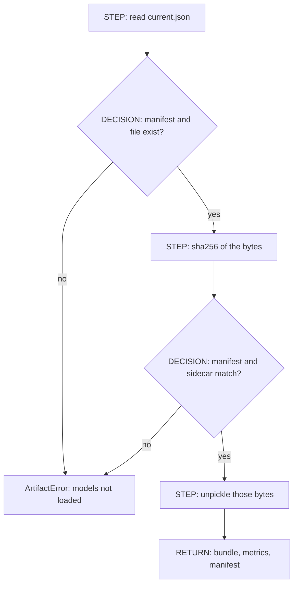

# Card: hash-checked model artifact

Code: `load_bundle` in [backend/app/ml/artifacts.py](../../backend/app/ml/artifacts.py), used by `load_models` in [backend/app/main.py](../../backend/app/main.py).
Tests: `TestArtifact` in [backend/tests/test_training.py](../../backend/tests/test_training.py).

## The question

"pickle.load runs code. How do you make sure the API only loads the model you trained?"

## How to catch it in an interview

Listen for: model registry, supply chain, versioning, "someone swapped the file". Write the hash at training time,
check the bytes before unpickling, refuse on any mismatch.

## Flowchart

## Slips (what this change fixed)

- Before: `models.pkl` and `knn_similar.pkl` were unpickled from disk with no check.
- Hash the bytes you load, not the path: reading the file twice leaves a window to swap it.
- A refused model leaves `models_loaded: false` on `/health` instead of crashing the API.

## Interviewer questions and how the code answers

| Question | Answer in the code |
|---|---|
| How do you roll back? | `MODEL_VERSION` pins `models-<version>.pkl`; old versions stay in the folder. |
| Does a hash stop an attacker who can write the folder? | No, they can rewrite the manifest too. It stops corruption and accidental swaps; signing would be the next step. |
| Where do models live in production? | Local `MODEL_DIR`, or S3 behind `MODEL_S3_URI`; the hash is checked after download too. |

## Twists

- Sign the manifest (KMS or Sigstore) so the hash itself is trusted.
- Use a non-executable format (ONNX, XGBoost JSON) and drop pickle.
