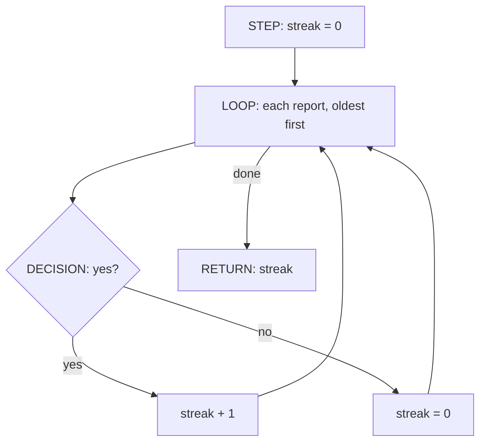

# Card: consecutive-yes streak

Code: `consecutive_yes_streak` in [backend/app/services/trust_score.py](../../backend/app/services/trust_score.py).
Tests: [backend/tests/test_trust_streak.py](../../backend/tests/test_trust_streak.py).

## The question

"29 yes, 1 no, 1 yes. Is that a 30-day streak? Count it in one pass."

## How to catch it in an interview

Listen for: streak, run length, "consecutive", reset. A count over a window is not a run; walk the events once and
reset on every miss.

## Flowchart

## Slips (what this change fixed)

- Before: `COUNT(*) FILTER (WHERE taken)` over 30 days, so the penalty depended on totals, not on an unbroken run.
- SQL returns newest first (`ORDER BY event_date DESC LIMIT 60`); the code reverses it before the walk.
- The same change fixed `:pid::uuid`, which SQLAlchemy does not read as a bind parameter, so the trust-score and
  reminder endpoints failed on Postgres.

## Interviewer questions and how the code answers

| Question | Answer in the code |
|---|---|
| Time and space? | O(n) time, O(1) space, one pass. |
| Why only the last 60 events? | The penalty only needs to know if the current run reaches 30. |
| Longest streak instead? | Track `best = max(best, streak)` inside the loop. |

## Twists

- Count days, not events, when several doses fall on one day.
- Allow one snooze inside a run without resetting it.
